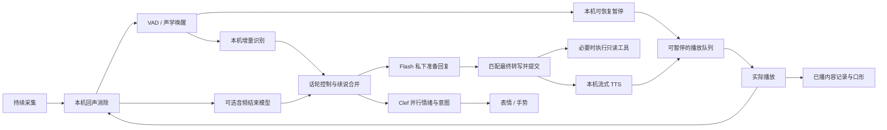

# 澪：近似全双工语音对话研究

研究日期：2026-10-23，Asia/Shanghai。对象是现有 Swift「桌面来信」，保留 Tencent `deepseek/deepseek-flash`、本机 ASR/TTS 与 Clef。本文区分本轮测量、上轮基线、作者公布结果和待验证方案；本轮没有替换模型、重启应用或发布新语音功能。

## 结论

最适合当前项目的是**带话轮控制的流式级联**。持续收音、回声消除和播放分开运行；用户开口先在本机可恢复地暂停，随后区分附和、回答、纠正与真正打断。Flash 提前准备回复，但在话轮提交前不播放、不执行工具；Clef 并行决定情绪和回应方式。

现有机器的短句 ASR/TTS 并行计算能跟上。主要缺口在控制逻辑：一听到声音就清空旧播放、固定静音阈值、只在结束后调用 LM、中间识别会改写、历史只记录整句播放完成。这些都不是“换一个更大的模型”能自动解决的。

本轮最有决策价值的证据：

| 问题 | 测得的结果 | 对方案的影响 |
|---|---|---|
| Flash 还要多久才能说话 | 当前提示词 12 次：提交文字→首个非静音 PCM 中位 1.334 秒，P95 1.951 秒 | 需要重叠等待与生成；这个数不含用户说话、端点、ASR和扬声器 |
| Clef 能否负责立即停声 | 72 次文本选择中位 319 ms；6 次音频选择中位 2.526 秒、最慢 10.345 秒 | 立即暂停在本机；Clef 保留为并行语义/表情判断 |
| 只把静音阈值缩短是否可行 | 344 段自然中文离线回放中，450 ms 风格策略提前提交 147 段 | 单一短阈值不能作为完成判据；这不是线上误打断率 |
| 本机是否算不动 | 4 轮短句并行：72 次 ASR 请求 P95 116 ms，12 次 TTS 全完成 | 此负载下没有算力瓶颈证据，长会话仍要测 |
| 暂停后能不能接着说 | 离线原生播放：四个暂停位置，恢复后与连续渲染逐采样一致 | 可以实现保留原句的软暂停，无需重做整个播放器 |

原始数据统一在 [`evidence/mio_duplex_research_20261023/`](../../evidence/mio_duplex_research_20261023/)，汇总为 `metrics-summary.json`。所有分位数统一采用 NumPy 线性插值；小样本 P95 只描述本轮，不是服务等级承诺。

## 1. “近似全双工”需要做到什么

同时采集与播放只是基础。面向日常对话，还需要以下不同动作：

| 用户的行为 | 澪应如何处理 |
|---|---|
| 澪讲解时用户轻声“嗯、对” | 暂时降低音量或暂停，确认附和后从原位置继续 |
| 澪问“要继续吗”，用户答“嗯” | 接纳为完整答案，不能按短字数丢掉 |
| 用户说“等一下”“不是明天，是今天” | 立即让出声音，保留用户内容，取消旧回答并重算 |
| “嗯，对，我还有个问题” | 不能在前两个字时把整段丢弃 |
| “我想……那个……” | 继续听，不能把思考中的停顿当作说完 |
| “打开网页……不，先别打开” | 中间识别可以触发私下准备，不能提前执行任务 |
| 用户继续原话，旧网络请求才回来 | 合并连续输入；旧文字、音频、表情、工具结果都要检查版本 |
| 旁人说话、键盘声、自己的回声 | 不应当作用户下达了新请求；需要真实声学验收 |

可以先做“可打断、可恢复、能容忍附和”的近似双工。边说边把用户补充融入同一句回答是更高阶段，不能把两者混为一项完成。DuplexCue 对协作性插话的研究也把继续、调整、让出分开评估；其数据是英语，不能直接当作中文指标。[Continue, Adapt, or Yield](https://arxiv.org/html/2609.13117v1)

## 2. 当前实现的事实

检查基线为仓库 `01fd524eaa374f1a53852174e184dbd106027b18`。相关路径：

- [`VoiceAudio.swift`](../../native/mio-companion/Sources/MioApp/VoiceAudio.swift)：输入输出共享 AVAudioEngine，已启用 Apple VoiceProcessing；16 kHz 输入、24 kHz 播放。`interrupt()` 使用 `player.stop()`，没有保留播放位置的暂停态。
- [`VoiceController.swift`](../../native/mio-companion/Sources/MioApp/VoiceController.swift)：160 ms 一批送本机前端；检测到 `.began` 即取消旧回复；中间 ASR 只显示文本，最终 ASR 才请求 Flash。Clef 并行调用，超时 2 秒，并未从正常语音路径删除。
- [`VoicePipeline.swift`](../../native/mio-companion/Sources/MioCore/VoicePipeline.swift)：400 ms 预留音频、累计 120 ms 语音触发、450 ms 静音结束、约 1 秒一次整段前缀识别、最长 25 秒一段。
- [`voice_frontend.py`](../../native/mio-companion/tools/voice_frontend.py)：Silero + 声学唤醒，32 ms 内部帧、160 ms HTTP 包。ASR/TTS 为本机独立进程。

需优先解决的具体问题：

1. **软暂停缺失。** 附和一旦触发 `.began`，就清空 PCM 并取消 LM/TTS。原回答不能原位恢复。
2. **历史与真正听到的内容不完全一致。** 当前只提交播放完的短句，被打断的半句不在历史中；无已播整句时还可能删除上一条用户输入。不能简单改成“生成完就写历史”。
3. **中间识别不是最终意图。** Qwen 整段重识别会修正前文；一次甚至两次相同 partial 都不代表用户已经说完。
4. **端点和传输时钟混合。** `lastSpeechClock` 用前端响应到达时间反推帧位置；积压时不能准确代表原始采集时间。
5. **播放队列与取消边界。** 当前合成可领先播放数秒；软暂停期间仍有新 PCM 到达，`enqueue()` 内自动 `play()` 必须受暂停态约束，否则会自行恢复。
6. **会话窗口是固定到期时间。** 长回复、工具等待、用户长句要保持当前对话活跃，不能在正常对答途中因为 25 秒窗口到期丢弃输入。

上一轮已验收基线是六条合成语音按实时速度回放：说完→实际播放器非静音采样中位 **2.537 秒**，其中静音结束检测约 619 ms、最终 ASR 72 ms、LM 首字约 1.523 秒。程序主动取消到播放停止约 11 ms，**不是**从真人开始插话算起的延迟。[上轮 Flash 实测](MIO_VOICE_FLASH_20261022.md)

## 3. 网上方案的取舍

### 3.1 适合借鉴的级联框架

| 方案 | 可借鉴的能力 | 当前项目的限制与选择 |
|---|---|---|
| LiveKit Agents | 附和识别、误打断恢复、话轮边界保护、抢先生成、播放完成记录 | 自适应插话模型需要 LiveKit Cloud 凭据，独立部署也如此；采用整套框架是可选路线，不能称为纯本机组件 |
| Pipecat | `SpeculationGate` 隔离生成与外部效果；最终转写匹配；状态与音频帧到达顺序分开处理 | 最适合借鉴取消、提交与回放语义；不需要把 Swift 主程序重写成 Python |
| Smart Turn v3.2 | 本地小型音频轮次结束模型，能看语调和末尾语境 | 判断“说完没”，并不直接判断“这句嗯是不是打断”；本轮中文测试未显示可以放心套默认阈值 |
| speech-swift | Swift/MLX/CoreML 的语音组件、SmartTurn、若干流式识别器、音频时钟设计 | 逐个组件评估。检查到通用 `VoicePipeline` 的流式 STT 回调仍为空，不能因为底层有流式模型就认定整条管线已流式化 |

LiveKit 在回答开始/结束附近保留保护窗口，防止把纠正或刚回答的问题误当成附和；这是应当采用的原则。其本地 `v1-mini` 只输出结束概率，不提供云端的附和概率。代码 Apache-2.0 与模型专用许可是两件事：本机安装包标注 `Apache-2.0 AND LicenseRef-LiveKit-Model`，模型条款要求配合 LiveKit Agents，不能直接独立嵌入 Swift。本轮发现这一限制后未继续扩展独立模型实验，也不将它加入应用依赖。[自适应打断](https://docs.livekit.io/agents/logic/turns/adaptive-interruption-handling/)、[轮次模型](https://docs.livekit.io/agents/logic/turns/turn-detector/)、[模型许可](https://huggingface.co/livekit/turn-detector/blob/main/LICENSE)

Pipecat 的提前生成隔离思路更适合当前架构：未提交的文本、TTS、工具调用都应隔离，既处理“先生成完再确认”，也处理“先确认、首帧稍后才到”的顺序。它的 `NormalizedMatch` 会忽略大小写和标点；项目若涉及数字、网址或代码，不能直接把这种等价关系当成执行工具的授权。优先严格匹配，接受少复用一些候选。[Pipecat 源码](https://github.com/pipecat-ai/pipecat/tree/76563d11d053c1cc9c621fc2a25e24e6454be5a4/src/pipecat)、[speech-swift](https://github.com/soniqo/speech-swift/tree/7baf2781d5c6a5d38b008a96eef3dca61c55f369)

### 3.2 原生双工模型并非当前首选

| 模型/项目 | 已核实的支持 | 此轮结论 |
|---|---|---|
| Moshi | 官方仓库提供 Mac/iPhone MLX 路径，双音频流 | 可研究真正连续听说；本机中文能力、角色声音与工具能力未验，不能直接代替 Flash |
| Kyutai Unmute | STT→任意文本 LM→TTS 级联；官方部署面向 Linux/CUDA | 不要把 Moshi 的 Mac 支持误套到 Unmute 服务上 |
| PersonaPlex | 角色/声音条件的原生双工；代码与权重许可分别处理 | 本轮未下载权重、未测中文与本机延迟 |
| MiniCPM-o 4.5 / Comni | 中文/英文、多模态双工；当前 Comni/llama.cpp-omni 已有 macOS Metal 路径 | 值得作为第二阶段对照。Demo 的 1 秒输入单元不等于 200 ms 声学打断；角色声线、工具和本机效果还须实测 |
| Nemotron VoiceChat / speech-swift | 有原生 Swift/MLX 路径与工具调度实现 | 本轮仅阅读源码；未把第三方演示延迟当作本机中文性能 |

来源：[Moshi](https://github.com/kyutai-labs/moshi)、[Unmute](https://github.com/kyutai-labs/unmute)、[PersonaPlex](https://github.com/NVIDIA/personaplex)、[MiniCPM-o](https://github.com/OpenBMB/MiniCPM-V)、[Comni Demo](https://github.com/OpenBMB/MiniCPM-o-Demo)、[llama.cpp-omni](https://github.com/tc-mb/llama.cpp-omni)、[原生 VoiceChat](https://github.com/soniqo/speech-swift/blob/main/docs/inference/voicechat.md)。

原生双工模型可以连续理解声音，但仍需回声消除、工具权限、队列取消、说话历史与角色动画。用户指定的 Flash 能力、现有 Vivian 声音及 Clef 分工都已存在，因此先改善控制层的成本和可验证性更好。

### 3.3 论文的快，测的是哪一段

| 研究 | 值得借鉴 | 不能直接套用的数字/条件 |
|---|---|---|
| Voice-Light | 可恢复音量控制、推测生成、按播放提交历史 | 作者 758 ms 是端点之后到服务端首音频，排除端点等待与设备播放；36 轮、3 位操作者、英语/GPU。其因果轮次头真实结束召回约 12.5%，实际依赖 Silero 回退 |
| DuplexCascade | 把对话控制和生成按微话轮组织 | 涉及专门训练、LoRA 和额外控制结构；不能只给现有 Flash 换提示词就得到同样能力 |
| RelayS2S | 快慢模型分工、验证继续内容 | 81 ms 的 P90 是到首五个可合成单词，不含端点、网络和 TTS；快模型与验证器经过训练，附和判断也仍有明显错误 |
| D2 | 分块大小、连续性与响应速度一起权衡 | 公布的 521 ms 响应/403 ms 打断不含实际计算与网络；并非此 Mac 的声学测量 |
| DuplexAct-Bench / Full-Duplex-Bench | 同时检查时机、内容、主动静默、插话与旁人干扰 | 可用于制定覆盖面，不能替代自己的中文用户、麦克风和扬声器验收 |

来源：[Voice-Light](https://arxiv.org/html/2609.20995v1)、[DuplexCascade](https://arxiv.org/html/2603.09180v1)、[RelayS2S](https://arxiv.org/html/2603.23346v1)、[D2](https://arxiv.org/abs/2610.17124)、[DuplexAct-Bench](https://arxiv.org/abs/2609.39446)、[Full-Duplex-Bench](https://github.com/vtrinh-nvidia/Full-Duplex-Bench)。Voice-Light 仓库快照没有明确代码许可，本轮仅研究思路，未复制实现。

### 3.4 云端识别作为对照

Soniox 有流式最终/非最终 token 与语义端点；它明确说明，激进端点会减少修正时间，也可能把长话切成更多段。可作为中文云端对照，但本轮未调用收费 API，不能给出从本机到服务端的延迟或排名。[Soniox 端点说明](https://soniox.com/docs/stt/rt/endpoint-detection)

Deepgram Flux 的 `EagerEndOfTurn`/`TurnResumed`/`EndOfTurn` 事件设计值得借鉴；当前官方 Flux 多语言清单为十种语言，没有中文，不能把 Nova 的中文覆盖误算成 Flux 的能力。[Flux 官方演示及语言表](https://flux.deepgram.com/)、[结束检测配置](https://developers.deepgram.com/docs/flux/configuration)

AssemblyAI 的旧模型页仍能搜到“六种语言”，但 2026-09-29 发布的 Universal-3.6 Pro Streaming 已是 32 种，包含普通话。要核对具体版本；其新发布对比指标来自英语测试，不是中文优势证明。本轮未实测。[新版本发布](https://www.assemblyai.com/blog/universal-3-6-pro-realtime)、[官方集成参考](https://github.com/AssemblyAI/assemblyai-skill/blob/main/skills/assemblyai/references/streaming.md)

## 4. 本轮测量

### 4.1 环境与方法

本机 Apple M5 Max、128 GiB、macOS 27.0.1 arm64。保留原 8311 ASR、8312 TTS、8313 声学前端；研究依赖安装在独立 `.build/duplex-research`，没有改正式语音环境。`audio.cpp` 检查版本为 `5b772fe040d4102ec59a557e045ef29e3ab5480d`。

- Python 3.12.13，ONNX Runtime 1.31.0，sherpa-onnx 1.13.8；SmartTurn 使用 CPU 单线程并含特征提取时间。
- 16 条本机 Vivian 合成中文覆盖停止、短答案、改口、否定、日常提问。音频只用于静音推理。
- SmartTurn 发布者测试集：80 条中文全部是合成音频，40 条英语为自然音频；每种语言按正负各半选取，预测前固定。
- LiveKit EOT 数据集：全部 344 条中文 validation，约 67.2 分钟，755 个中途停顿、344 个最终停顿；不是随机收集的本项目用户会话。
- 从上述自然中文按 ID 的 SHA256 排序，预先取 48 条 2–30 秒样本，共 466.77 秒，比较 ASR 中间结果。数据集的文字参考有错字和繁简混用，未将编辑距离当作可靠 CER 排名。

数据集归属与许可：[SmartTurn 测试集，CC BY 4.0](https://huggingface.co/datasets/pipecat-ai/smart-turn-data-v3.2-test)、[EOT 中文数据，CC BY 4.0](https://huggingface.co/datasets/livekit/eot-bench-data)。EOT benchmark 代码的 Apache-2.0 许可不等于数据许可。本轮不分发音频或第三方权重。

### 4.2 轮次结束：计算很快，但不能单看正确结束的速度

音频模型计算时间：Smart Turn v3.2 CPU 中位 **31.88 ms**，P95 **32.41 ms**；LiveKit mini 中位 **4.16 ms**，P95 **4.26 ms**。这只表示一次推理的耗时。

在 80 条发布者合成中文片段上，0.5 阈值下 SmartTurn 判对 66 条，mini 判对 48 条；这不是公平的跨模型训练外排名。mini 当前中文默认阈值为 **0.355**，不是这个片段实验的 0.5。英语 40 条的表现也不能替代中文自然对话。

随后对 344 条自然中文做了两种离线回放：一组直接使用标注停顿；另一组用与正式前端相同的 Silero 参数，从因果音频前缀判断。下面是后一组，模型在检测到约 224 ms 静音时评分一次，并按 160 ms 交付批次计算时间。

| 策略 | 快路径 / 低分回退等待 | 提前提交段数 / 344 | 未提前提交且有结果的段数 | 这些段的结束等待中位 / P95 |
|---|---:|---:|---:|---:|
| 固定 450 ms 风格 | 实际按 32 ms 帧累计至 480 ms | 147 | 195 | 460 / 580 ms |
| 固定 700 ms 风格 | 704 ms | 80 | 262 | 700 / 800 ms |
| 固定 1200 ms 风格 | 1216 ms | 23 | 319 | 1200 / 1320 ms |
| SmartTurn，阈值 0.5 | 350 / 1200 ms | 160 | 182 | 360 / 1219 ms |
| SmartTurn，阈值 0.8 | 350 / 1600 ms | 138 | 204 | 380 / 1680 ms |
| mini，中文阈值 0.355 | 350 / 2500 ms | 99 | 243 | 360 / 2578 ms |
| mini，阈值 0.5 | 350 / 1200 ms | 81 | 261 | 440 / 1300 ms |
| mini，阈值 0.8 | 350 / 1600 ms | 7 | 335 | 1580 / 1700 ms |

必须连同限制理解：

- 所有策略另有 **2 条未触发提交**；时间从标注的最终静音开始计算，不是人工校准的声带停止时刻。
- “提前提交”指尚未到标注最终停顿就结束该段，不等于已经向用户播放抢话。LM 生成期间用户续说，仍有机会取消。
- 表格的延迟只统计没有提前提交的不同子集，存在选择偏差；不能只横向取最小中位数宣布胜出。
- 这是结束策略回放，没有逐行模拟原应用的开始门限、25 秒切段、识别、网络、恢复或实际播放。每段首次提前提交后即记失败，不模拟后续纠错。
- 阈值/回退组合事先固定，没有在这 344 条上搜索最优值；它们是比较策略，尚不是部署配置。
- 数据由 LiveKit 发布，SmartTurn 的片段集由其自身发布者提供。未复刻官方 benchmark 的全部采样、精度、阈值搜索或其他语言，不引用厂商排名作为本轮排名。

可得出的结论是：**模型推理成本小，轮次策略的误判代价大**。直接加 SmartTurn 默认阈值没有在本轮中文自然停顿中解决问题；mini 的保守组合减少了提前提交，却主要靠等待更久。下一步应以本项目中文会话校准，并保留续说合并与候选回复丢弃。

原始结果：`turn-clips.json`、`turn-eot-zh.json`、`vad-eot.json`。实现参照：[SmartTurn](https://github.com/pipecat-ai/smart-turn)、[EOT benchmark](https://github.com/livekit/eot-bench)。

本机可查看[结束策略对照图](../../evidence/mio_duplex_research_20261023/endpoint-tradeoffs.png)及[可导出的 PDF](../../evidence/mio_duplex_research_20261023/endpoint-tradeoffs.pdf)。

### 4.3 ASR：流式输出、增量识别与最终意图是三件事

| 方案 | 本轮实际检查 | 取舍 |
|---|---|---|
| 当前 Qwen3-ASR 0.6B / Metal | 16 条合成句；48 条自然中文累计 1557 次 320 ms 前缀请求；另有实时回放 | 最终人名和词语较适合当前项目，但整段重识别会改写，早期音频过短时会出现提示词内容 |
| 中文 Zipformer INT8 / CPU | 同一批 16 + 48 条；真实流状态、缓存和增量输出 | 前缀稳定、低成本；合成样本有“进程→进城”“澪→明”等错误，不能只因为稳定就换成正式 ASR |
| Apple SpeechTranscriber | 本机已安装 zh_CN/zh_TW；16 条加速、4 条实时、48 条自然语音实时 | `fastResults` 对实时反馈必要；这轮未显示明显胜过现有 Qwen 的短句首字延迟或角色人名识别 |
| Nemotron 3.5 ASR Streaming 0.6B | 阅读模型卡、Swift/CoreML/MLX实现，未下载权重 | 真正缓存式多语流识别候选；普通话属于 broad-coverage 组，不能把英语速度/准确率套过来 |
| FunASR | 阅读官方流式与 vLLM 实现 | Paraformer 是缓存流式；新的 Fun-ASR-Nano vLLM 流式仍累计重编码，名字里“streaming”不代表同一技术 |

16 条干净合成句的最终规范化完全匹配：Qwen 14/16、Zipformer 9/16。样本很小且音色单一，不能当自然中文准确率。实际 160 ms 节奏回放中，“停一下”首次完整出现：Qwen 320 ms 前缀约 **702 ms**，当前 1 秒节奏约 **1097 ms**，Zipformer约 **1145 ms**；计时起点是音频文件开始，不是物理发声开始。

Apple `fastResults` 在四个样本中的首结果约 **1.15 秒**；默认普通模式为约 **1.94–4.08 秒**，经常到句尾才出结果。48 条自然语音的实时检查完成，但这类文件带有不等长前导静音，不能直接拿文件起点的首字时间排名。[Apple SpeechAnalyzer](https://developer.apple.com/videos/play/wwdc2025/277/)、[fastResults](https://developer.apple.com/documentation/speech/speechtranscriber/reportingoption/fastresults)

若采用 Apple 新 API，需要检查系统版本与语言资产；不能让目前 macOS 14 起步的应用无条件依赖较新系统的识别接口。

两个应纳入回归的真实中间识别序列：

```text
输入：“帮我打开网页，不，先别打开。”
约 0.96–1.60 秒可用音频：帮我打开网页。
约 1.92 秒：开始出现“不”
约 2.88 秒：帮我打开网页，不，先别打开。

输入：“查看进程，不要关闭。”
极短前缀有时返回：人名：澪（读 líng），小澪，晴町。
继续输入后才回到实际说话内容。
```

48 条自然样本的 Qwen 前缀实验从整个文件起点开始，保留了长前导静音；其中不少初期文本出现在标注说话前。这是**不加起音门控的实验反例**，不能声称正式应用有同等比例的幻觉。正式应用已有 VAD 门控与 400 ms 预留；未来提高 partial 频率时仍须保留门控、最少有效语音和空白过滤。该实验的请求总计算/往返时间约 211 秒、请求中位 105 ms，但它是加速顺序发送，不代表 467 秒现场对话的完整资源占用。

针对提示词泄漏补做相同 16 条音频的无提示词对照：最终完全匹配降为 13/16，“小澪”变成“小明”；极短前缀仍会出现无关单字。去掉提示词并未解决短音频问题，不能把它当作直接修复。该对照仍只是同一合成小样本，结果在 `asr-qwen-no-prompt.json`。

源码进一步核实：当前 `audio.cpp` 的 Qwen 流接口会按窗口处理，并非共享实时编码器状态；官方 Qwen3-ASR 的 vLLM streaming 也保留累计音频与可回退 token。Fun-ASR-Nano 官方说明同样是累计重编码、保留未定尾部。不要把“返回 token 流”误写成“音频编码器完全增量”。[Qwen3-ASR](https://github.com/QwenLM/Qwen3-ASR)、[Fun-ASR vLLM 流式说明](https://github.com/QwenAudio/Fun-ASR/blob/c0a20e2bb698bbad11d143bdccd6c0760e9d6e5b/docs/vllm_guide.md)、[Nemotron 模型卡](https://huggingface.co/nvidia/nemotron-3.5-asr-streaming-0.6b)

### 4.4 Flash 与 TTS

使用 JCode 中现有 Tencent 配置，真实返回模型 ID 为 `deepseek/deepseek-flash`，`thinking` 关闭，`max_tokens=220`，共享 HTTP 客户端。六个合成问题×两轮×两种提示词，顺序交错。密钥未写入证据或报告。

| 提示词 | 请求数 | 首文字中位 / P95 | 首分句中位 / P95 | 提交→首个非静音 PCM 中位 / P95 |
|---|---:|---:|---:|---:|
| 当前角色提示词 | 12 | 1085 / 1744 ms | 1195 / 1795 ms | 1334 / 1951 ms |
| 精简角色提示词 | 12 | 1139 / 1342 ms | 1265 / 1477 ms | 1405 / 1620 ms |

精简提示词没有改善中位数，不能据此删掉角色和行为约束。网络/服务波动、样本量和提示词缓存都影响结果；这轮 usage 未显示缓存命中。时间只是实验室文字提交后的首分句，不含 VAD、ASR 和物理播放；实验分句器与 Swift 的逗号处理略有差别，也不能称作整条原生管线复测。官方模型别名和版本映射会变，未来复测继续记录返回 ID，不擅自改成另一个 Flash 型号。[Tencent 当前接口与模型表](https://cloud.tencent.com.cn/document/product/1823/130078)

当前 Qwen3-TTS 同一句话，三轮交错分块测试：

当前接口接收完整文本分句，再分块返回音频；这不等于向同一 TTS 会话持续追加 LM token 的双向流式文本输入。本轮首字到首分句约百毫秒，优化这一段可作为后续工作，但应同时验证跨分句韵律与不断句的听感。

| 最大 codec 帧/事件（grow 策略） | 首非静音 PCM 中位 | 合成耗时/音频时长中位 RTF |
|---:|---:|---:|
| 1 | 63 ms | 0.49 |
| 3 | 79 ms | 0.30 |
| 6，当前配置 | 85 ms | 0.27 |
| 12 | 89 ms | 0.25 |

每组仅三次，采样种子未固定、生成时长会变；不能把 22 ms 差值当精确因果收益。`grow` 从小块逐步增长，最大块数也不等于首包大小。1 帧没有解决端到端主要等待，却增加明显计算开销。先保留 6，之后以听感和实际设备欠载率决定是否用 3。

另做 5 次断开长 TTS 流后立即请求新短句：全部成功；平时首非静音中位约 79 ms，替换请求约 250 ms。源码的 socket 写失败会终止回调并释放忙锁；这表示请求可以在后续发送边界退出，不等于任意 GPU 运算都能瞬时抢占。

4 轮交错的并行负载中，每轮一条约 5 秒合成语音按实时节奏做 320 ms ASR，配合三条连续 TTS 生成：ASR 72 次均成功，P95 116 ms；TTS 12 次完成，首非静音中位约 80 ms、RTF约 0.28。单独 ASR P95约 121 ms。差异不足以宣称并行更快，只能说明这批短句没有观察到明显竞争退化。没有同时进行长时间 GPU 渲染压力、系统重负载或真人收音。

原始结果：`flash-probe.json`、`tts-probe.json`、`concurrent-voice.json`。

### 4.5 Clef 应当保留，但要放对位置

初始 24 个合成上下文各重复三次：72/72 请求成功，57/72 与预设标签一致，即 19/24 个独立场景三轮均正确。中位 319 ms、P95 825 ms。问题集中在短答案和不完整话头，例如“你要继续吗？——嗯”仍被当成附和；这是合成文本探针，不是自然声学准确率。

再固定 32 个新场景，明确提供“是否正在问用户”“片段是否完整”等状态：模型单独 24/32，加入保护规则后 27/32。仍会错判“哦，可是我没找到”“让我说一句”等内容；其中一次错误附和的模型置信度达 0.926。**置信度不是校准后的可靠概率，也不能越过上下文保护。** 这些明确状态由测试夹具提供，现场如何可靠获得它们还未验收。

六个相同合成上下文分别测试文本、音频、文本+音频：三种方式都只有 5/6 标签一致。音频中位 2.526 秒、最慢 10.345 秒；文本+音频中位 2.121 秒、最慢 5.576 秒。加音频没有在这六例中修复短答案错误，还显著增加等待。不能把这当作完整自然韵律评测，也不应把当前音频 Clef 请求放在立即停声路径。

建议分工：

- **本机**：回声消除、起音、可恢复暂停、明确停止、队列和会话版本。
- **Clef 文本决策**：并行选择倾听/回应方式、情绪、眉眼与手势；使用已播上文和当前问题状态。超时或不确定时保留内容，继续收音。
- **Flash**：理解完整问题、自然回复和已获准的简单只读工具。
- **TTS 与角色**：实际 PCM 决定口形；本机倾听态立即变化，Clef 结果晚到时必须检查当前话轮。

这仍使用当前 Clef 决策接口，没有引入 embedding 替代它。`Clef-flash` 的本地 Swift 实现是另一个模型候选，不等于现有 `Clef-Omni` 已经在 Mac 原生运行；此轮不替换。[Clef-Omni 模型卡](https://huggingface.co/Cloudflare/clef-omni)、[本地 Clef-flash 实现说明](https://github.com/soniqo/speech-swift/blob/main/docs/models/clef.md)

### 4.6 原生播放器可恢复性

本轮新增独立探针 [`duplex_playback_probe.swift`](../../native/mio-companion/tools/research/duplex_playback_probe.swift)，使用 AVAudioEngine **离线手动渲染**，不打开输入输出设备。

四个位置各检查三种行为，共 12 例通过：

- `pause → play`：拼回的暂停前后音频与不暂停参考完全一致，最大采样误差 0，暂停期间输出 0。
- `stop → play`：四个失败对照都检出了剩余音频丢失，说明探针能发现现有破坏性停止不能续播的问题。
- `stop → 新音频 → play`：没有旧音频漏入新响应。

暂停时 `playerTime` 在此探针返回不可用，因此必须在暂停前保存游标；不能在暂停后再向节点索要可靠位置。Apple 文档也说明 `stop()` 清空调度并重置时间线，`pause()` 用于暂停。[AVAudioPlayerNode](https://developer.apple.com/documentation/avfaudio/avaudioplayernode)

这不能证明真实扬声器瞬停、回声消除或真人自然度。Apple VoiceProcessing 不支持用手动渲染替代真实 IO 验收；下一步仍需内置扬声器、耳机、蓝牙分别测试。不要叠两套 AEC；若 Apple 路径不足，再评估带真实播放参考和时钟同步的 WebRTC AEC。[Apple Voice Processing](https://developer.apple.com/videos/play/wwdc2019/510/)、[WebRTC 音频处理架构](https://webrtc.github.io/webrtc-org/architecture/)

## 5. 建议接入的管线



图中播放到 AEC 的箭头是回声参考。工具有结果后仍需进入同一版本校验和回答流程，不能绕过提交控制直接发声。时间、角色设定、近期对话继续进入 Flash/Clef；界面不增加决策来源提示。

### 5.1 状态与时序

| 状态/事件 | 立即发生的行为 | 保留的东西 |
|---|---|---|
| 等待唤醒 | 本地轻量声学检测，按原权限状态收音 | 有界预留 PCM，不发到云端 |
| 已唤醒、用户开始说话 | 独立采集任务持续供帧；澪进入倾听表情 | 当前用户片段及原回答 |
| 澪说话时检测到用户声音 | 短淡出并暂停，先不销毁响应 | 队列、游标、已播历史、当前 epoch |
| 确认只是附和 | 从原队列恢复，继续听后续内容 | 附和片段可暂留用于发现紧随的请求 |
| 确认回答/纠正/新请求 | 旧响应 epoch 失效，取消 LM/TTS，清队列 | 已播历史与用户输入，不能盲删上一条用户话 |
| 发现一个可能结束的停顿 | 可启动至多一个私下候选回复 | 不公开音频、文字或工具副作用 |
| 用户续说或 ASR 改写 | 关闭释放门、丢弃失配候选，合并用户片段 | 新的完整输入 |
| 提交话轮 | 校验候选输入与最终转写；相同可复用，否则重新请求 | 只发布有效版本 |
| 播放完成或澪问问题 | 延长跟进窗口 | 用户可直接回答，无须再叫名字 |

`turn committed` 是系统的轮次判断，不是保证用户永远不会续说。即使收到 ASR final，之后仍可能追加“不，先别”。因此播放前再次检查是否恢复收音，错误提前提交要能撤销，工具尤其要守住提交门。

### 5.2 四条必须保持的约束

**输入、生成、播放各有时钟。** 在采集回调记 `captureSampleIndex` 和单调时钟；重采样后保留映射。前端响应到达时间不能代替采集时间。不得在音频回调里做网络请求、文件写入或等待主线程；使用有界环形队列，由后台任务取帧。

**软暂停与硬取消分开。** 软暂停不增响应版本，也不删历史；硬取消才使旧响应失效。暂停期间新 PCM 只能入有界缓存，不能通过 `enqueue()` 自动重新 `play()`。设备切换或采集停止时，明确终结两条路径，不能遗留恢复定时器。

**所有异步结果携带身份。** 至少区分会话、用户片段、ASR 修订、响应 epoch、分句和工具请求 ID。取消请求不代表远端已立刻停止计算；每个 `await` 后与每次播放/表情/工具结果提交前都要检查身份。旧回调不能清除新会话的 busy 状态。

**历史按听到的内容记。** 保存已生成、已排队、已播放三个状态。当前 TTS SSE 没有逐字对齐，不能按字符数线性猜听到哪一个字。第一阶段保留已播完整短句，并标记被打断半句；若要精确续接，再增加字词对齐和设备播放时间换算。不得把未播放候选作为澪已经说过的话。

### 5.3 提前生成的边界

建议先让 **LM 提前、TTS 少量预备、输出延后提交**。候选最多一个，每次最多预备首个短句；它的文本和音频只在私有缓存。当前用户增加否定、数字、对象或问题内容，候选即失效。工具调用在正式提交前全部禁止，即使模型已经产出了调用参数。

不要用语义相似度判定“差不多可以复用”；“打开”和“不要打开”很相似，但动作相反。优先逐字匹配或非常保守的格式规范化，网址、数字和代码保持精确。只剩标点差异而重新生成，也比播放错误回复更可接受。

大致延迟关系应按时间线算，而不是把所有阶段简单相加：

```text
若私下已经生成音频：
首声时间 = max(话轮提交时间, 有效候选音频就绪时间) + 实际播放等待

若只提前生成文字：
首声时间 = max(话轮提交时间, 有效首分句就绪时间) + TTS首声等待 + 播放等待
```

只有候选与最终输入匹配才享受重叠收益。实际收益必须扣掉误判重做、丢弃候选的调用成本和尾部延迟；不能把所有用户都假定为一句话一次说完。

### 5.4 初始参数是实验起点

| 项目 | 建议实验起点 | 限制 |
|---|---|---|
| 采集与控制帧 | 保留 Silero 32 ms，控制消息尝试 32–64 ms | 当前 HTTP 每160 ms，先测本机处理与队列成本，再决定内嵌还是长连接 |
| 起音软暂停 | 在澪发声时走更早的本地 VAD 分支，不等最终 ASR | 不能仅靠音量门限；以键盘、咳嗽、回声的误暂停率约束 |
| partial ASR | 从 1 秒向 320–640 ms 试验，保留有效起音门控 | 同时最多一个识别请求，合并过期 partial；final 优先 |
| 结束检测 | VAD + 文本完整性 + 可选音频模型；不直接上线本轮阈值 | 中文留出集评估后选择；犹豫、数字、改口要能等更久 |
| TTS | 保留 6 帧 grow；减少过多预生成 | 先限制候选数、分句数和 PCM 秒数，再观察实际欠载 |
| 附和过滤 | 已明确问问题/结束说话时保护短答案；仅把完整、单纯附和作为恢复候选 | 不允许 Clef 仅凭一个高置信度丢弃后续混合请求 |
| Clef | 并行文本决策，超时不阻塞停声或回复 | 当前音频请求不放在关键路径 |
| 长会话 | 活跃采集、播放、工具期间保持唤醒；安静后再倒计时 | 不把“停止播放”“停止聆听”“退出应用”混为一条命令 |

## 6. 如何验收，才能说它真的更自然

以下是下一阶段建议目标，**本轮没有达到或验收这些整机指标**：

| 指标 | 下一阶段目标/要求 | 测量起止 |
|---|---|---|
| 软暂停响应 | P95 ≤ 250 ms，按设备分别报告 | 人类语音实际起音→扬声器实际降音/停声 |
| 明确停止处理 | 短停止语句识别后及时取消；同时报告起音到取消 | 分开记录声学起音、关键词明确、epoch取消、最后扬声器采样 |
| 有内容的首声 | 日常短问答争取中位 ≤ 1.5 秒、P95 ≤ 2.5 秒 | 用户实际说完→与问题有关的首个人声；“嗯/好的”填充不算完成 |
| 假打断恢复 | 从原位置恢复，零重复/丢字，报告恢复延迟 | 附和结束→原回答续播 |
| 不完整句 | 记录提前提交率、实际抢话率，两者分开 | 含长停顿、改口、数字和思考词的中文留出集 |
| 历史与任务 | 未播放内容不记为已说；旧结果不能发声或执行 | 检查用户/响应/工具 ID 与真实播放账本 |
| 稳态负载 | 连续会话无持续积压、无遗留推理任务 | 采集队列长度、ASR backlog、TTS缓冲、CPU/GPU/RSS、丢弃候选量 |

物理声学矩阵至少覆盖：内置扬声器、耳机、Bluetooth；正常/较大音量；近讲/远讲；背景电视/音乐、键盘声、咳嗽；人声与澪同时说；设备路由切换、睡眠唤醒、LM/Clef/TTS 超时。检测旁人说话与回声不能靠纯文本夹具证明。当前用户的麦克风/外放条件仍未在本轮打开或录制。

语义矩阵至少覆盖 20 类：普通问答、短答案、纯附和、附和后新请求、明确停止、否定停止、引用停止词、纠正时间、纠正对象、犹豫长停顿、数字中停顿、连续改口、用户续说、双人串话、未唤醒讲话、重复唤醒、长回复后回答、工具途中改意、旧 TTS 晚到、设备断开恢复。先固定样本和通过标准，再调阈值；调参集与最终留出集分开。

回声评价要同时看只播放澪时的残留，以及人和澪重叠时用户语音有没有被误消除；“安静时没有回声”不能代表双讲通过。研究中已有 AEC 单讲/双讲分开评测的方法可参考。[ICASSP AEC Challenge](https://arxiv.org/abs/2309.12553)

## 7. 推荐实施顺序

| 阶段 | 具体改动位置 | 该阶段的验收边界 |
|---|---|---|
| 1. 可恢复播放与版本清理 | `VoiceAudio.swift` 增加 pause/resume；`VoiceController.swift` 区分软暂停与硬取消、保护旧回调和历史 | 先通过离线采样连续性及乱序/取消测试，再真实外放；不改变模型 |
| 2. 话轮控制 | 新增独立可测试的 `TurnCoordinator`；本地起音快速分支、短答案保护、续说合并、跟进窗口 | 中文语义矩阵及实际暂停/恢复，先保守处理不确定片段 |
| 3. 减少首次回答等待 | partial识别调度、私下Flash生成、严格提交门、有界首句TTS | 同时报告有效首声、误抢话、候选浪费和旧结果泄漏 |
| 4. 识别器与结束模型 A/B | 在相同播放器和控制层下比较 Qwen、真正流式ASR、可选结束模型 | 相同中文留出集、相同设备、相同网络时段；单独报告人名、短词、改口 |
| 5. 原生双工对照 | MiniCPM-o/其他已明确许可且支持Mac中文的候选，独立开关 | 角色声音、工具正确性、中文自然度与延迟一起评，不用单个demo替换正式路径 |

第一阶段最重要：它既改善自然度，又使后续更快的判断犯错时能够恢复。第二阶段成熟后才释放推测生成的声音，避免让更快的生成变成更快的抢话。

## 8. 复现、来源与范围

### 本地入口

原生离线播放器探针的可重复命令在 [`tools/research/README.md`](../../native/mio-companion/tools/research/README.md)。其余研究脚本和依赖保留在本机忽略目录，默认不会上传音频或模型：

| 脚本/结果 | 内容 |
|---|---|
| `lab/turn_benchmark.py` → `turn-clips.json`, `turn-eot-zh.json` | 发布者片段与标注停顿的因果前缀评分 |
| `lab/vad_eot_probe.py` → `vad-eot.json` | 正式参数风格 Silero 结束策略回放；不是完整应用 |
| `lab/asr_benchmark.py`, `lab/natural_asr_probe.py` | 合成/自然 ASR 前缀、实时节奏与改写记录 |
| `lab/apple_asr_benchmark.swift` | Apple batch、real-time、fast/normal 对照 |
| `lab/flash_probe.py` | 24 条真实 Tencent 请求，首分句真实 TTS；仅在进程内读取现有密钥 |
| `lab/tts_probe.py`, `lab/concurrent_voice_probe.py` | TTS分块、断流后恢复、ASR/TTS争用 |
| `lab/clef_turn_probe.py`, `lab/clef_audio_probe.py`, `lab/clef_guard_probe.py` | 合成上下文及受限音频判断，不发送用户会话 |
| `metrics-summary.json`, `verification.json` | 本轮汇总及范围声明 |

这不是一键下载所有模型的安装器。复测第三方模型前须重新核对各自条款；LiveKit mini 不能用上述独立探针作为推荐生产集成，Zipformer 这套具体权重的再分发许可此轮未确认。官方 Nemotron 当前模型卡是 OpenMDW-1.1、未设 gated；不要沿用旧 Swift 文档中“必需登录门控”的描述，更不把代码许可当作权重许可。

### 固定版本

主要源码快照与原始文件保留在 `sources/`，快照 JSON 记录完整 SHA：

| 来源 | 本轮固定版本 |
|---|---|
| Pipecat | `76563d11d053c1cc9c621fc2a25e24e6454be5a4` |
| SmartTurn 代码 | `4786657e242dfe77dd138699ac564ee074a2a543` |
| LiveKit Agents | `7a7547e442aaf9cf6f6cab54dd5db6f7cfb5a964` |
| LiveKit EOT benchmark代码 | `9ee21b52840e167c58bb4d67fbf2d13fb26240b5` |
| Qwen3-ASR | `7c6daf77a2421100f5fb066495372c00129d39ff` |
| speech-swift | `7baf2781d5c6a5d38b008a96eef3dca61c55f369` |
| MiniCPM-V | `dfe5db0cabf054c4615c796306a51f9b0ee399ca` |
| MiniCPM-o-Demo | `47709a9210dfd71afa76c058e017fc8c4db5c8d2` |
| Voice-Light | `40720d64cc6fda26857025e394edc42bc4fe68cb` |
| SmartTurn片段数据 | `dfc179241fee65b0efe81ca37786f41ce26f38ec` |
| EOT自然中文数据 | `ca9d98a9686b920a2d8c9eb984224ba9be74e4dd` |

本轮只交付研究、诊断工具和接入设计，应用仍是原 v28。真人插话、外放 AEC、Bluetooth、长期自然对话与上述性能目标均未验收；不以离线推理、合成回放或论文结果替代。
