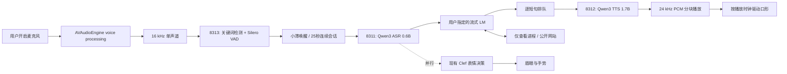

# 桌面来信的低延迟语音管线（2026-10-22）

## 结论与交付边界

本机适合复用已安装的 audio.cpp / Metal：Qwen3-ASR-0.6B 识别，Qwen3-TTS-1.7B CustomVoice 流式合成，外接 OpenAI 兼容的文本 LM。Swift 负责采集、回声处理、会话、取消、工具和播放，继续使用原 `io.harumachi.MioCompanion` 应用。Clef 并行选择表情，不阻塞生成第一句话；没有 embedding，也没有另建桌面应用。

已实现并验证的链路是：合成语音回放 → 声学唤醒 → 神经 VAD → 真实本机 ASR → **模拟 LM** → 真实本机 TTS → 原生静音播放与 Live2D 口形。真实进程查询、公开网页读取、多轮上下文和取消也已验证。实际 LM 的地址、模型和密钥尚待用户选择；真人麦克风、扬声器回声、日常噪声误唤醒和真实端到端延迟尚未验收。不能把本轮模拟 LM 的耗时当作真实对话性能。

“最快、最好”必须限定硬件、中文语料、噪声、音色和统计口径。本轮选取可复用本机模型且已经实测的方案；没有跨供应商同条件质量评测，不声称它在所有环境下最快。

## 调研比较

| 方案 | 对本项目有价值的能力 | 本轮取舍 |
| --- | --- | --- |
| [LiveKit Agents](https://docs.livekit.io/agents/logic/turns/tuning/) | 回合结束、打断、提前生成、只记录已播放内容；适合远程多客户端/WebRTC | 采用其会话设计原则。本机单人 Swift 应用没有引入房间服务器；这不是对框架性能的否定。以后网页/手机同时接入优先复评 LiveKit |
| [Pipecat Smart Turn](https://github.com/pipecat-ai/smart-turn) | VAD 停顿后判断语义是否说完，支持中文；v3.2 有小型量化模型 | 是进一步减少句中抢话的候选。当前没有安装或宣称已经接入，暂用神经 VAD + 短静音窗口 |
| [sherpa-onnx KWS](https://k2-fsa.github.io/sherpa/onnx/kws/pretrained_models/index.html) | 按发音匹配可配置关键词，中英 3M 模型、chunk-8 支持 160 ms 模型分块 | 已接入 CPU int8；“小澪”按 `xiǎo líng` 检测，避免生僻字识别错误导致叫不醒 |
| [Silero VAD / sherpa 示例](https://github.com/k2-fsa/sherpa-onnx/blob/master/python-api-examples/vad-microphone.py) | 神经语音活动检测 | 已接入；主路径不再只靠音量阈值判断人声。RMS 只保留在纯逻辑测试的备用接口 |
| [Kyutai Unmute](https://github.com/kyutai-labs/unmute) | 可组合 STT、任意文本 LM、TTS 的流式服务 | 官方部署目前面向 Linux / CUDA，Mac 不在其支持范围；不能直接当成本机方案 |
| [MLX Audio](https://github.com/Blaizzy/mlx-audio) | Apple Silicon 上的 ASR/TTS 和流式音频能力 | 本机 Python 环境存在，但此前 MLX 权重已清理；当前 GGUF 权重与 audio.cpp 已齐备，先复用已有安装 |
| [Qwen3-TTS](https://github.com/QwenLM/Qwen3-TTS) / [技术报告](https://arxiv.org/abs/2601.15621) | 中文、流式合成、可选音色与声音设计 | 采用本机 CustomVoice / Vivian。报告中的 97 ms 属于其特定实验口径，不作为本机整轮延迟 |
| [audio.cpp](https://github.com/0xShug0/audio.cpp) | C++ / ggml，多后端、本机 HTTP 和流式音频 | 已有 Metal 构建和 GGUF 模型，不需要重新下载大模型。实际能力以已安装二进制及接口测试为准，不把上游全部模型支持等同于本机能力 |

原始 ASR/TTS 服务设为 `max_loaded_models=1`，两种模型共用时可能反复加载。当前分成两个只监听回环地址、常驻各自模型的进程，避免在一次对话中换模。未改动原共享 8300 服务。

本机 Qwen3-ASR 的“streaming”模式是音频窗口处理，不应等同于带增量缓存的原生实时转写。因此当前每秒进行一次唤醒后预览识别，停顿后另做最终识别；预览不直接触发 LM 或工具，避免错误部分转写执行动作。

## 实际管线



- 声学前端每次接收 160 ms PCM，用 32 ms VAD 子帧；关键词与 VAD 在 CPU 执行，ASR/TTS 使用 Metal。
- 未唤醒时不调用 ASR、LM 或 Clef；轻量前端仅在内存处理音频。停止采集会删除前端会话，遗留会话 30 秒超时。
- 唤醒后连续说话，回复播放完后 25 秒内可接话。可以打开“免唤醒连续聆听”。“停止聆听 / 关闭语音”会关闭麦克风，“结束对话”回到等待唤醒。
- VAD 累积约 120 ms 人声开始一轮；静音门限 450 ms，按 32 ms 帧量化后最多 480 ms，另有神经 VAD 与 160 ms 传输分块产生的检测延迟。最大语句 25 秒；前置缓冲约 400 ms 保留开头。
- 用户再次说话时，取消 LM、TTS 和旧播放缓冲，并拒绝旧请求迟到的音频块。回合历史仅保留已完整播放的短句，不把生成但未听到的内容放进历史。最近 12 条消息保留在内存。
- LM 接口采用 SSE；每个可朗读短句立即送 TTS，不等全文。分句队列、PCM 队列和服务响应均有上限。数字、小数、千位逗号和 URL 避免被错误切开。
- 同一音频引擎用于采集与播放，调用 Apple voice processing；原生播放测试开启进程内静音，不修改系统音量。实际声学回声消除效果仍需外放实测。
- TTS 将角色名“澪”替换为同音“玲”后合成，界面和对话历史保留“澪”。未经替换的 TTS 样本存在错读，已保留负例。

## 测量口径与结果

测试时间：2026-10-22；本机已安装模型，单用户合成中文语句，无真实麦克风。

| 阶段 | 本机观测 | 边界 |
| --- | --- | --- |
| KWS + VAD | 160 ms 输入块平均约 2.1–2.3 ms，最大约 3.3 ms | CPU 处理耗时，不包含模型分块等待、用户说完关键词的时间 |
| ASR 六个不同句子 | 中位 88.2 ms，范围 64.2–259.4 ms | 1.76–5.36 秒合成音频的完整 HTTP 转写，微基准不带专有名词提示、不包含端点判断；不是 WER 或 p95 |
| TTS 六个不同句子首包 | 中位 44.9 ms，范围 43.3–64.4 ms | 首包可能是静音，不能称为开始听见声音 |
| TTS 首个非静音包 | 中位 105.1 ms，范围 101.8–124.5 ms | 使用归一化 RMS > 0.003 检测包；尚未计入声卡缓冲及音频内前导静音 |
| 原生链路 | 真实唤醒/VAD/ASR/TTS + 模拟 LM 跑通，原窗口持续出帧，实际执行进程工具 | 仅模拟接口传输与本机播放验收，非真实 LM 智能/延迟证明 |
| 取消 | 打断后约 400 ms 的观察窗内无新增播放块，口形归零 | 观察窗长度不是“停止花了 400 ms”；尚未测真人声音打断的端到端 p95 |

最初同一句预热重复请求首包 17–19 ms、ASR 69–71 ms；它不能替代上表的不同句子与非静音检测。冷图初始化样本首包约 154 ms、ASR 561 ms，也不包含整个服务加载时间。

端到端需要分别测：最后一个用户语音采样 → 端点确认 → ASR 完成 → LM 首字 → 首个可朗读短句 → TTS 首个非静音包 → 声卡播放。不能把 TTFT、生成音频时长或离线合成速度当作完整回应延迟。

暂定目标是安静环境短句 **中位约 1 秒、p95 低于 1.5 秒**；这是后续真机验收目标，不是本轮已达标结果。需要低 TTFT 的 LM、较短首句与稳定网络。选择模型时应优先对比首句时间和工具调用正确率，不能仅比较总 tokens/s。

## 受限任务与数据

- `list_processes`：只有用户本轮提出查看进程时可执行。固定 `/bin/ps` 参数，不拼 shell；只返回前 12 项名称、PID、CPU%、MEM%，不返回完整命令行或个人路径。没有终止进程能力。
- `read_website`：用户明确给出的公开 HTTPS 页面，主机、路径及查询参数须匹配原链接，DNS 检查排除私网地址，不携带登录态、不跟随重定向；最多读取 256 KB，仅向 LM 提供前 4,000 字文本。网页正文作为不可信资料，不能扩大工具权限。不是交互式浏览器、搜索引擎或登录网站自动操作。
- 麦克风由原应用中的“开启语音”申请系统权限，启动应用不自动开始采集；暂停、锁屏、睡眠或检测服务异常会停止采集。此处“自动唤醒”指开启后的声学唤醒，不指绕过系统授权或从睡眠中唤醒 Mac。
- 音频仅发往 127.0.0.1；只有已唤醒的对话文本及用户请求的工具结果发往指定 LM，文本另发给现有 Clef 判断表情。原始音频不落盘；本轮证据 WAV 全部为主动合成测试素材。
- 密钥通过 SecureField 输入，按 LM 地址隔离保存到 macOS Keychain；设置只保存地址/模型。修改地址不会把旧密钥发给新地址，单轮请求固定配置，拒绝带凭据或 query 的 Base URL。网络错误不回显服务器正文。

## 启动与接入

统一入口仍为仓库根目录 `open_mio_companion.command`。它启动已有语音模型的隔离进程、构建并打开原应用；服务启动失败时仍可使用原来的文字来信。

新机器需已有兼容的 audio.cpp 安装与模型。`MIO_AUDIOCPP_HOME` 指向包含 `server.json`、`models/`、`audio.cpp/` 的目录；默认使用用户目录下 `workpath/research/asr`。小型声学前端使用 Python 3.12+，首次安装：

```bash
python3 native/mio-companion/tools/setup_voice_frontend.py
python3 native/mio-companion/tools/voice_services.py start
python3 native/mio-companion/tools/voice_services.py status
./open_mio_companion.command
```

前端运行库安装在本项目 `.build/voice-frontend`，模型在 `.build/voice-models`，下载有 SHA-256 校验，不修改系统 Python。三个进程的配置、PID、日志位于 `.build/voice-services`。原共享 8300 服务不受影响。原应用包已更新并重启，麦克风保持未开启，实际 LM 未配置。

在“语音对话 → 设置”填写 LM Base URL（包含 `/v1` 或服务自己的前缀）、模型 ID、Key，保存后开启语音。也支持 `MIO_LM_BASE_URL`、`MIO_LM_MODEL`、`MIO_LM_API_KEY` 环境变量。现有 Clef `/v1/systemone` 只做决策，不能充当开放式 LM 回答接口。

原窗口文字输入在配置 LM 后也进入这条会话，可关闭“朗读回复”。尚未配置 LM 时保留原 Clef/本地台词库。

## 验证与剩余工作

证据目录：`evidence/mio_voice_pipeline_20261022/`。

- `varied-benchmark.json`：六条不同合成语音的 ASR、首包和非静音包时间。
- `frontend-benchmark.json`：三个正确发音正例均触发；两个普通中文负例未触发。另保留 TTS 错读原字的失败样本，不能将这个小样本当作误唤醒率评测。
- `native-final/`：生产唤醒/VAD/ASR 路径的实际声学回放、模拟 LM 对话、多轮历史、取消、进程读取、网页读取和窗口截图；测试静音，没有麦克风采集。
- `tests.log`：112 项 Swift XCTest，108 通过、4 项其他可选网络测试跳过、0 失败；真实本机语音与模拟 LM 测试显式启用。
- `project-check.log`：仓库 8,082 项检查通过。最终原应用前台复核时 Mac 锁屏，CUA 无法查看前台；自有窗口渲染与声学回放证据不能替代真人麦克风验收。

测试接口 `tools/voice_lm_fixture.py` 仅监听 127.0.0.1:8320，支持碎片 UTF-8、分段工具参数、截断和 HTTP 503；仅供回归，不作为实际模型。原生 `--review-voice <目录>` 必须设置 `MIO_VOICE_TEST_SILENT=1`。可用 `MIO_VOICE_REPLAY_WAV` 指向合成语音 WAV，经真实生产入口回放。`MIO_VOICE_WEB_TEST=1` 增加公开网页只读验证。

待用户选择 LM 后：测真实首字/首句、中文回答、工具决策及网络尾延迟；在用户麦克风上检查小声、距离、电视声、外放回声与打断。然后优先评估 Smart Turn 的中文句中停顿与语义结束判断、增加误唤醒长时负例，并据真实测量调整 450 ms 端点。暂不提前调用工具，也不把未经确认的部分转写送去执行。
